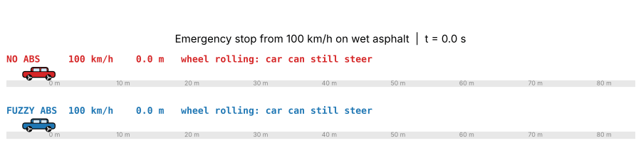
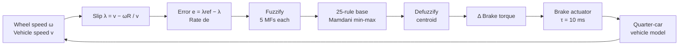
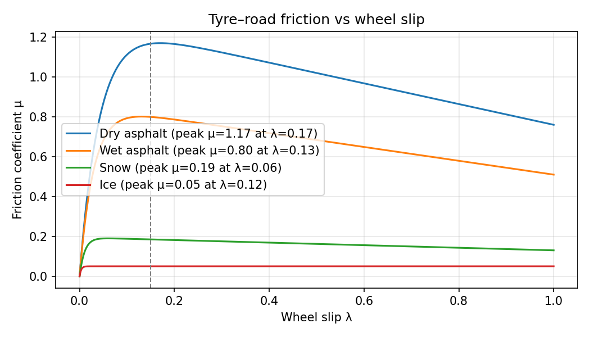
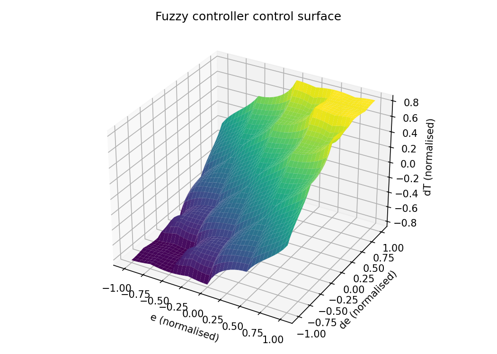
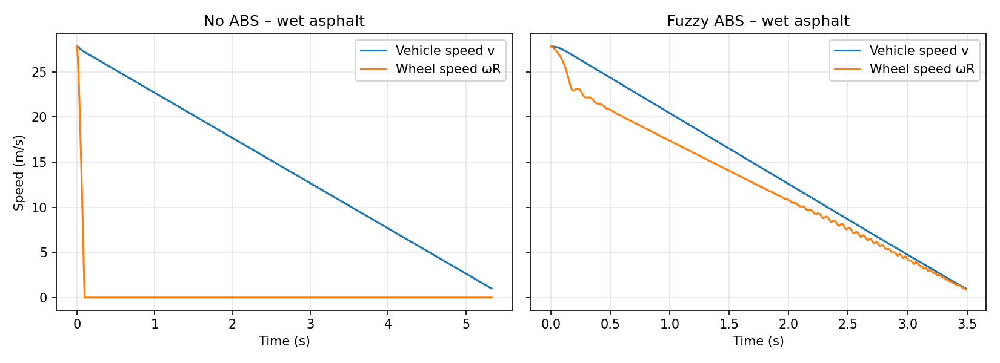
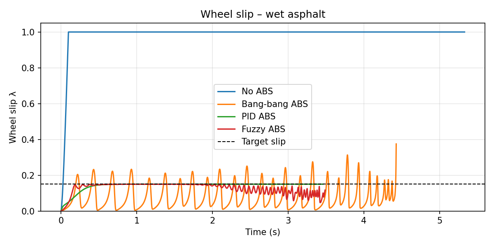
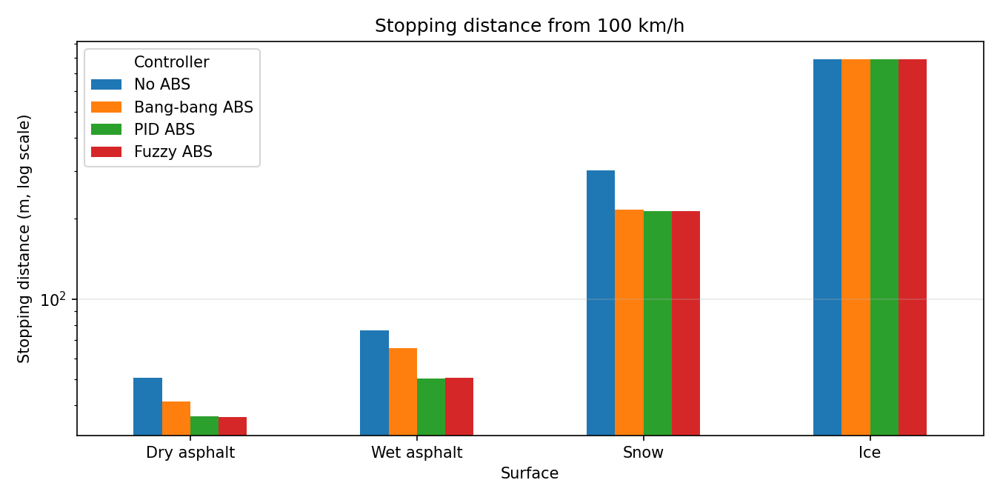
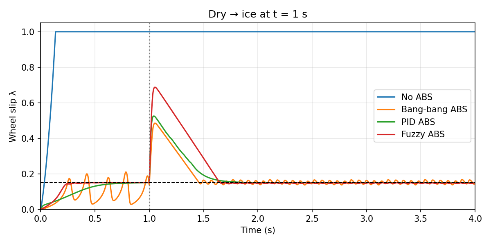

<div align="center">

# 🚗 Fuzzy Logic Anti-Lock Braking System

**Stopping a car from 100 km/h without locking the wheels, using a 25-rule fuzzy controller.**

[](https://colab.research.google.com/github/bipashadeka/fuzzy-abs/blob/main/Fuzzy_ABS_Simulation.ipynb)




*Same car, same wet road, same 100 km/h. Without ABS the wheel locks in 0.1 s and the car skids with no steering. With fuzzy ABS the wheel keeps rolling and the car stops **25.6 m shorter**.*

</div>

---

## ⚡ Results at a glance

| | No ABS | Bang-bang ABS | PID ABS | **Fuzzy ABS** |
|---|:---:|:---:|:---:|:---:|
| Stopping distance, dry asphalt | 50.8 m | 41.2 m | 36.4 m | **36.1 m** |
| Stopping distance, wet asphalt | 76.4 m | 65.6 m | **50.3 m** | 50.8 m |
| Stopping distance, snow | 302.2 m | 215.7 m | **213.1 m** | 213.7 m |
| Wheel locks on any surface? | ❌ Always | ✅ Never | ⚠️ Snow & ice | ✅ **Never** |
| Sudden dry → ice switch | 433.6 m, locks | 383.7 m | 333.3 m, locks | **327.7 m, no lock** |

- 🛑 **29% shorter** stopping distance on dry asphalt and **34% shorter** on wet asphalt, compared with no ABS
- 🎯 **22% shorter** than a classic bang-bang ABS on wet roads
- 🧊 The **only controller** that kept the wheel rolling when the road suddenly turned to ice, and the shortest stop in that test

> PID and fuzzy perform about the same on a steady road. Fuzzy's real advantage shows up when conditions change suddenly, which is exactly when ABS matters most.

---

## 🧠 How it works



### Why ABS is needed
Tyre grip depends on **wheel slip** λ, meaning how much slower the wheel turns than the car is moving. Grip peaks at around 10–20% slip and drops once the wheel locks (λ = 1). ABS keeps the tyre near that peak.

<p align="center"></p>

### Vehicle model (quarter-car)

| Equation | Meaning |
|---|---|
| $\lambda = \dfrac{v - \omega R}{v}$ | Wheel slip |
| $m\dot v = -\mu(\lambda)\, m g$ | Vehicle slows from tyre friction |
| $J\dot\omega = \mu(\lambda)\, m g R - T_b$ | Wheel spun by friction, braked by torque |
| $\dot T_b = (T_{cmd} - T_b)/\tau$ | Hydraulic brake lag |
| $\mu(\lambda) = c_1(1 - e^{-c_2\lambda}) - c_3\lambda$ | Burckhardt tyre–road friction |

**Parameters:** m = 350 kg · R = 0.3 m · J = 1 kg·m² · T_max = 1800 N·m · v₀ = 100 km/h · controller at 100 Hz · target slip 0.15

### Fuzzy controller design
- **Inputs:** slip error *e* and its rate *de*, scaled to [−1, 1]
- **Output:** change in brake torque, with an asymmetric gain that **releases fast** (600 N·m per step) and **re-applies gently** (150 N·m per step)
- **Membership functions:** 5 triangles per variable: NB, NS, Z, PS, PB
- **Inference:** Mamdani min-max with centroid defuzzification
- **Real-time trick:** the controller is pre-computed into a 41 × 41 lookup table, the same approach real automotive ECUs use

<table><tr><td>

| e \ de | NB | NS | Z | PS | PB |
|---|---|---|---|---|---|
| **NB** | NB | NB | NB | NS | Z |
| **NS** | NB | NB | NS | Z | PS |
| **Z** | NB | NS | Z | PS | PB |
| **PS** | NS | Z | PS | PB | PB |
| **PB** | Z | PS | PB | PB | PB |

</td><td></td></tr></table>

*Example rule: if slip is far above target (e = NB) and still rising (de = NB), release brake pressure strongly (NB).*

---

## 📊 Results in detail

### Wheel speed vs vehicle speed
Without ABS the wheel speed drops to zero almost instantly (locked). With fuzzy ABS it tracks just below vehicle speed: that small gap is the controlled slip.
<p align="center"></p>

### Slip control on wet asphalt
Bang-bang ABS oscillates around the target, PID and fuzzy settle smoothly, and no-ABS locks immediately.
<p align="center"></p>

### Stopping distance on all surfaces
<p align="center"></p>

### 🧊 Robustness: the road turns to ice mid-stop
All controllers were tuned on dry asphalt and then hit with a sudden switch to ice at t = 1 s, with no retuning. The fuzzy controller's fast-release design catches the wheel before it locks.
<p align="center"></p>

Full numbers: [`results/summary.csv`](results/summary.csv)

---

## 🚀 Run it yourself

**No installation:** click the **Open in Colab** badge at the top, then **Runtime → Run all**. It takes about a minute.

**Locally:**
```bash
git clone https://github.com/bipashadeka/fuzzy-abs.git
cd fuzzy-abs
pip install numpy scipy matplotlib pandas scikit-fuzzy jupyter
jupyter notebook Fuzzy_ABS_Simulation.ipynb
```

```
fuzzy-abs/
├── Fuzzy_ABS_Simulation.ipynb   # full simulation + animation, step by step
├── README.md
└── results/                     # animation, plots + summary.csv
```

---

## 🛠️ Key engineering decisions

| Decision | Why |
|---|---|
| **Control slip, not wheel speed** | Grip depends on slip, so slip is what the controller must regulate, whatever the vehicle speed |
| **Target slip 0.15** | Sits near the friction peak for dry (0.17) and wet (0.13) asphalt, the most common road conditions |
| **Asymmetric output gain (release 4× faster than re-apply)** | Mimics real ABS valves: a wheel about to lock must be released immediately, while re-applying slowly avoids overshoot. This one change fixed wheel lock in the dry-to-ice test |
| **Inputs e and de (PD-style rule base)** | The rate term lets the controller react *before* slip overshoots, which a slip-only rule base can't do |
| **Pre-computed 41 × 41 lookup table** | Full Mamdani inference is slow; interpolating a table gives identical output fast enough for a 100 Hz loop, as in production ECUs |
| **Brake actuator lag τ = 10 ms** | Real hydraulics can't change pressure instantly; without this the results would be unrealistically good |
| **Simulation step 0.1 ms, controller 10 ms** | Wheel dynamics are stiff at low speed; a small step keeps the integration stable while the controller runs at a realistic ECU rate |

## ✅ Model validation
- **Sanity check vs hand calculation:** without ABS on dry asphalt, the locked-wheel stop should be v₀²/(2μg) with μ(λ=1) = 0.76, giving **51.8 m**. The simulation gives **50.8 m** (the small difference is the 0.1 s before lock, when grip is higher).
- **Friction peaks** match published Burckhardt values: dry μ = 1.17 at λ = 0.17, wet μ = 0.80 at λ = 0.13.
- **Fair comparison:** all four controllers share the same vehicle, actuator, surfaces and target slip; only the control law changes.

---

## 🔍 Limitations & next steps
- **Quarter-car model:** one wheel only, with no load transfer between axles, suspension or steering. Next step: a full-vehicle model.
- **Fixed target slip (0.15):** on snow and ice the grip peak sits at lower slip, so a **surface-estimating adaptive target** would shorten stops further.
- **Ice results look identical** across controllers because the ice friction curve is almost flat beyond its peak. The benefit on ice is steering control, not distance.
- **Simulation only.** Next step: a ROS2 node and a hardware-in-the-loop test.

---

## 👩‍💻 Author
**Bipasha Deka**, Mechanical Engineering, Tezpur University
[LinkedIn](https://www.linkedin.com/in/bipasha-deka/) · [GitHub](https://github.com/bipashadeka)

*References: Driankov, Hellendoorn & Reinfrank, "An Introduction to Fuzzy Control"; Burckhardt, "Fahrwerktechnik: Radschlupf-Regelsysteme" (1993).*
