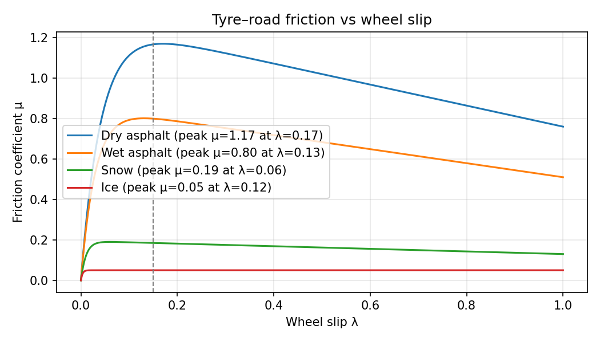
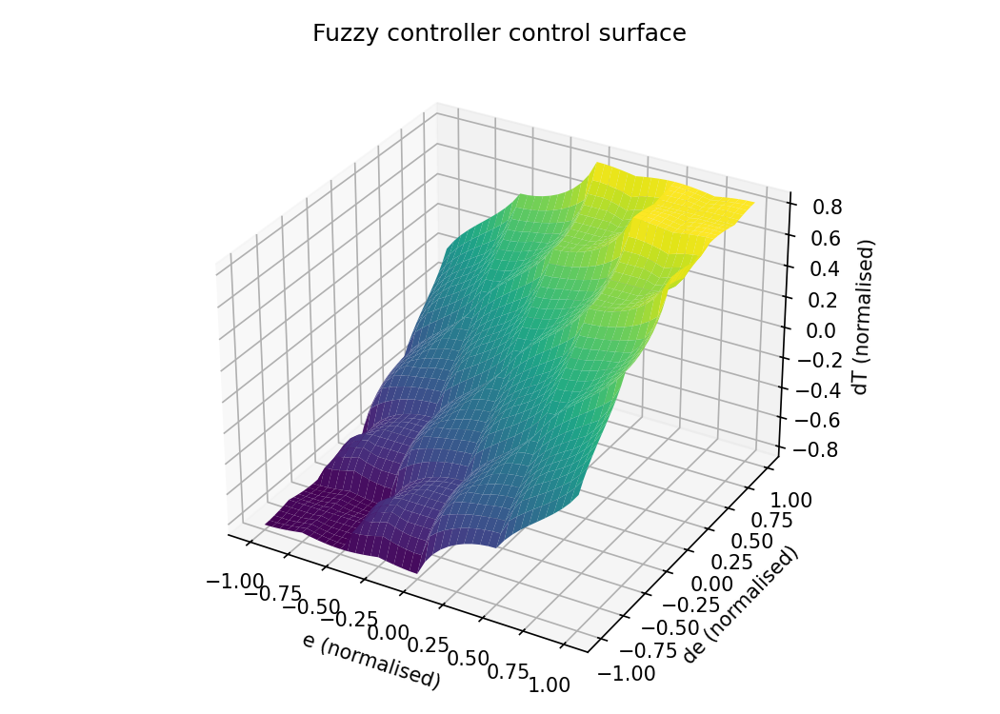
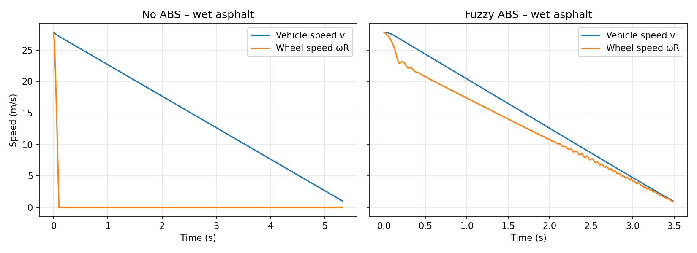
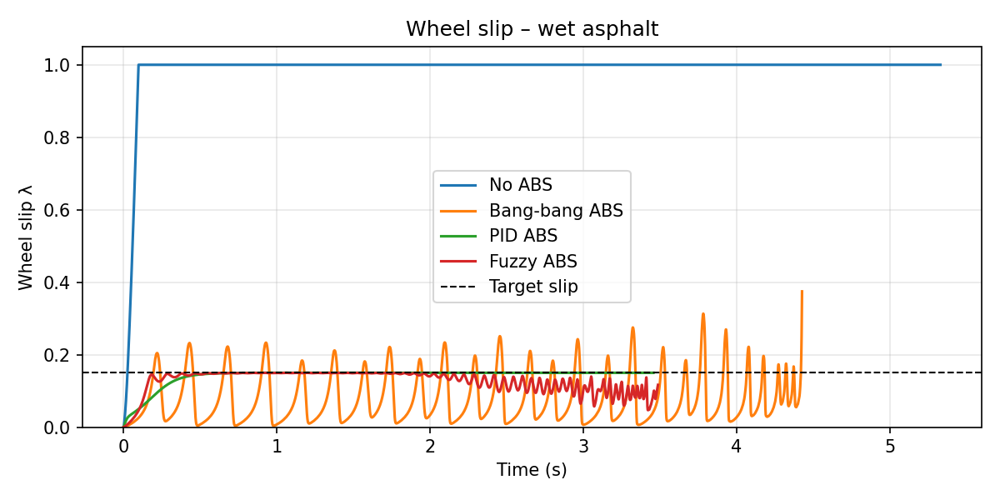
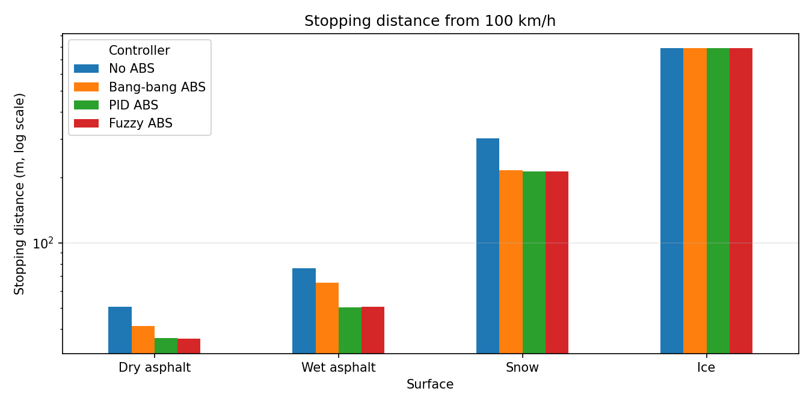
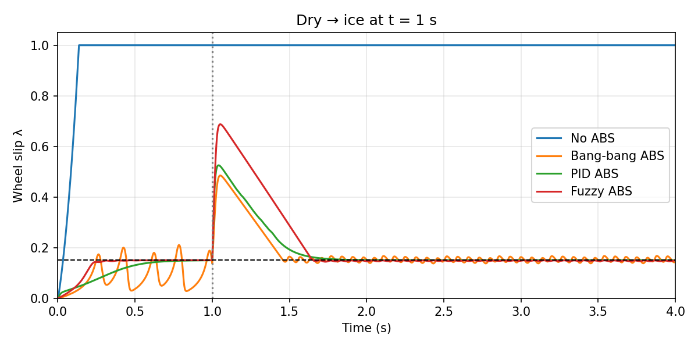

# Fuzzy Logic Controlled Anti-Lock Braking System (ABS)

A Python simulation of a quarter-car braking from 100 km/h, comparing four braking strategies on four road surfaces:
**No ABS**, **Bang-bang ABS**, **PID ABS** and a **Mamdani fuzzy logic ABS**.

## Model
- **Tyre–road friction:** Burckhardt model, μ(λ) = c1(1 − e^(−c2·λ)) − c3·λ, for dry asphalt, wet asphalt, snow and ice
- **Wheel slip:** λ = (v − ωR) / v
- **Vehicle:** m·dv/dt = −μ·m·g
- **Wheel:** J·dω/dt = μ·m·g·R − T_b
- **Brake actuator:** first-order lag, τ = 10 ms
- Parameters: m = 350 kg, R = 0.3 m, J = 1 kg·m², T_max = 1800 N·m, controller rate 100 Hz, target slip 0.15

## Fuzzy controller
- Inputs: slip error e = λ_ref − λ and its rate de (normalised to [−1, 1])
- Output: change in brake torque dT
- 5 triangular membership functions per variable (NB, NS, Z, PS, PB), 25-rule base
- Mamdani min-max inference, centroid defuzzification
- Pre-computed 41×41 control surface used as a lookup table (as in a real ECU)
- Asymmetric output gain: releases pressure fast, re-applies gently

## Results

Full numbers: [`results/summary.csv`](results/summary.csv)

### Robustness: road changes from dry to ice at t = 1 s (no retuning)

## Limitations
- Single-wheel (quarter-car) model; no load transfer, suspension or steering
- Fixed target slip of 0.15 — on snow and ice the friction peak is at lower slip, so a surface-adaptive target would improve results
- Simulated only; no hardware testing

## How to run
Open `Fuzzy_ABS_Simulation.ipynb` in Google Colab and click **Runtime → Run all**.
Requirements: `numpy scipy matplotlib pandas scikit-fuzzy`.
